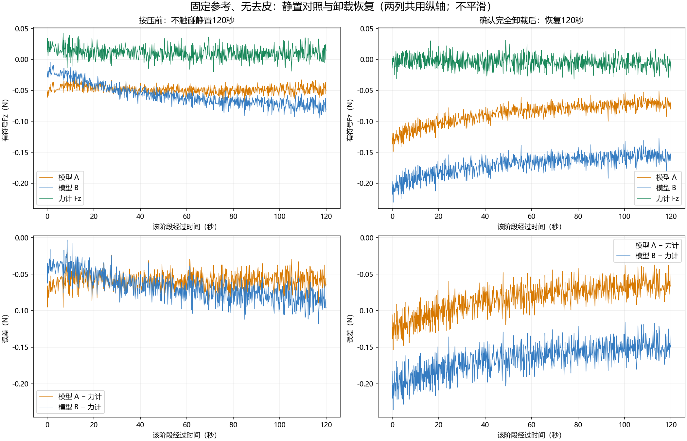

# 静置120秒与卸载恢复120秒对照（2026-11-06）

## 结论

同时存在按压前不接触阶段的慢漂移，以及加载后额外偏移并部分恢复。A相对力计的误差在120秒后接近按压前基线，但基线本身不为零；B只有部分恢复，120秒内明显没有回到按压前基线。不能把全部现象称为本次按压残留，也不能解释为纯自然漂移或神经网络历史累加。

## 记录与完整性

会话 `live_zh_20261106_165651_743795`。两段120秒及EXPERIMENT_COMPLETE、STOP均有事件。一次无载参考，无tare、无参考更新。共有3699个保存图像/预测行，未发现模型或配对力值非有限行。

按压前120秒有813帧，时间覆盖0.006–119.916秒；卸载恢复120秒有881帧，覆盖0.001–119.983秒。相机接收间隔中位分别164/149ms，最大357/216ms；不能冒称固定高频或精确曝光同步。力值使用与相机主机接收时间最近的有效原始样本，匹配门限30ms，无优化时移。

事前固定的统计窗口为每段0–10、30–40、60–70、110–120秒。没有按误差挑选时段、滤波、去皮或归零。573个窗口内原图逐一校验哈希并重算，两模型最大复算差均0.0N；会话记录的模型/前端/运行时来源哈希全部相符。

## 原始输出均值

| 时段 | A N | B N | 力计 N |
|---|---:|---:|---:|
| 静置0–10秒 | −0.045382 | −0.022057 | +0.016972 |
| 静置30–40秒 | −0.048838 | −0.052416 | +0.011813 |
| 静置60–70秒 | −0.050044 | −0.063777 | +0.008508 |
| 静置110–120秒 | −0.048203 | −0.075467 | +0.010080 |
| 卸载后0–10秒 | −0.120841 | −0.199503 | −0.002059 |
| 卸载后30–40秒 | −0.092885 | −0.174404 | −0.004015 |
| 卸载后60–70秒 | −0.081317 | −0.164718 | −0.004522 |
| 卸载后110–120秒 | −0.071456 | −0.156372 | −0.006385 |

不接触静置期间，A首尾均值仅变化−0.00282N，B变化−0.05341N。说明B在本次按压之前已经漂移，不能把其后全部变化都归因于本次按压。

从卸载后开始10秒到末尾10秒，A/B分别向零回升0.04938/0.04313N；确实有恢复过程。但是恢复末段相对按压前末段，模型原始输出仍偏负0.02325/0.08090N。

## 力计本身也有变化：用模型减力计重新比较

| 时段 | A−力计 N | B−力计 N |
|---|---:|---:|
| 静置0–10秒 | −0.06235 | −0.03903 |
| 静置110–120秒 | −0.05828 | −0.08555 |
| 卸载后0–10秒 | −0.11878 | −0.19744 |
| 卸载后110–120秒 | −0.06507 | −0.14999 |

力计按压前末段+0.01008N，恢复末段−0.00639N，自身改变−0.01647N。因此不能把A原始输出的全部−0.02325N改变都归到模型上。

- A：恢复末段相对按压前末段，额外误差约−0.00679N；接近原有基线，但不能据此称绝对零点已修复或物理合格。
- B：额外误差约−0.06444N；仍明显未恢复到按压前水平。
- 恢复最后60秒的原始输出线性趋势，A/B约+0.0125/+0.0110N每分钟，存在继续回升趋势；这只是描述性拟合，不用于修改输出，也不外推完全恢复时间。短窗口有波动，不能保证继续等待一定回零，更不能断言永久残留。

## 原图中的变化

| 时段 | 位移幅值P95 px | U中位 px | V中位 px | 有效率 |
|---|---:|---:|---:|---:|
| 静置0–10秒 | 0.04332 | +0.00544 | −0.00214 | 94.14% |
| 静置110–120秒 | 0.08164 | +0.03548 | −0.01730 | 94.11% |
| 卸载后0–10秒 | 0.19510 | +0.03736 | −0.07258 | 94.07% |
| 卸载后110–120秒 | 0.18775 | +0.04909 | −0.07295 | 94.04% |

位移既在按压前静置阶段增长，也在加载后达到更高水平；120秒后仍未回到按压前的空间状态。独立LK算法的四个代表帧也给出同方向证据，P95约0.0525→0.1013→0.2137→0.2044px。全局中位位移并非直接物理形变真值，不能据此单独断定胶体或相机哪个发生了变化。

有效率稳定，UV置零、保持每帧原掩码时，B输出由静置开始约−0.02770N至恢复末尾约−0.02857N，仅改变约0.00087N；真实UV下由−0.02206到−0.15637N。故大变化不是掩码比例下降或模型常数基线变化所能解释，而与变化的图像位移输入及模型敏感性有关。

蓝通道全图均值相对参考变化约−0.021→+0.127→+0.389→+0.362灰度级。曝光/自动曝光驱动返回−1、温度未记录；不能宣称已锁曝光，也不能仅凭全局亮度变化小就排除局部光学漂移。

## 自然漂移还是按压残留

可确认的是：**不接触也漂，按压后又出现额外偏移，随后部分恢复。** 这支持把问题分为“时间/参考相关漂移”与“加载后变化”两部分进行研发定位。

尚不能把两部分严格作物理因果定量分离：

1. 本实验前已经进行过其他按压，静置对照不是从未经加载、充分平衡的新材料状态开始；其慢漂移也可能含前次加载的恢复。
2. 本次从“开始按压”到“确认完全卸载”相隔186.69秒，期间力计最小约−15.739N，实际负载历史高于PR5约0–0.98N目标范围。不能直接推广为低载单次按压的恢复时间。
3. 没有一个与加载段等长、同温度/光学条件下的独立全程未按压对照，也没有可靠刚性背景/温度证据；不能把所有末段差异都称为本次按压造成，更不能断言是永久材料变形。

## 后续有区分度的实验

保持模型冻结，先做充分恢复后、全程不按压的等时长记录，再与预定载荷/保持时长的一次加载对照，最好交换试验顺序并重复。分别记录0.5N低载和需要研究的高载，避免不同峰值历史混在一起。延长卸载观察至5–10分钟可以观察是否继续恢复，但不能预先保证恢复；固定参考，不自动tare。

同时增加清晰刚性背景标记、相机固定与温度/光学记录，区分相机微动、触觉层恢复和光学变化。模型端应针对无载时间漂移/参考扰动建立测试，修复对这些变化的敏感性；不应通过强制置零关闭问题。

## 文件

- comparison.png：两段原始曲线及模型−力计误差，两列共用纵轴。
- metrics.json（本地保留）：固定窗口统计、采样间隔、事件时刻与源文件SHA256。
- image_diagnostics.json（本地保留）：573帧复算、位移/掩码/亮度指标与独立LK诊断。

所有原始会话及模型未修改。此次按用户授权公开汇总报告与曲线，原始图像和逐帧数据仍留本地。力计物理标定与曝光同步仍未独立验证。

## 模型端整改要求（CHANGES_REQUESTED，物理资格仍为 NOT_READY）

测试提交：`b2638776d8bff5cc6e3cad08a70d87ce03d9d604`。A=`lowmass_head60`，B=`lowmass_aug60`。本次仅分析和发布证据，不训练、不部署、不替换模型。

- [ ] 联合排查零UV/真实mask的非零基线、目标归一化与回归偏置、无载标签定义，解释A仍有零偏。
- [ ] 针对B完成固定参考下的真实无接触时间漂移、卸载恢复、亚像素位移、亮度与mask扰动消融；逐层给出原图→UV/mask→模型输入→原始Fz，区分输入变化和模型敏感性。不要把重新取参考后的低误差当作原参考下已恢复。
- [ ] 将本记录作为已检视回归证据，与前次参考敏感性诊断联合回放；冻结修复候选后，在新的独立会话做等时长无接触对照、预定载荷/时长的单次加载与5–10分钟恢复，重复并交换顺序。覆盖低载范围，范围外另报。
- [ ] 硬件/设备端记录温度、可核验曝光/增益、刚性背景标记及加载历史，区分触觉层恢复、相机/夹具微动与光学漂移。参考生命周期和时间配对留痕。
- [ ] 预先约定零偏、漂移、恢复、加载误差和延迟容差；同时报告原始输出与任何补偿输出。只做tare、减常数、自动换参考、强制归零、平滑或吸附力档，不能作为根因修复完成。

本报告不把材料残留、曝光变化或相机微动中的任何一项宣称为已确定根因。力计物理标定、同步和设备身份仍待核验。
